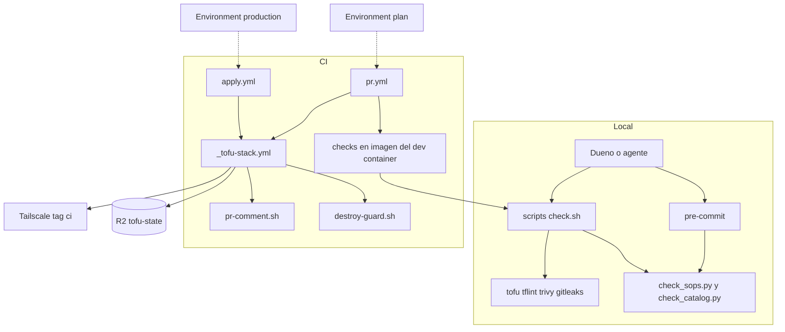
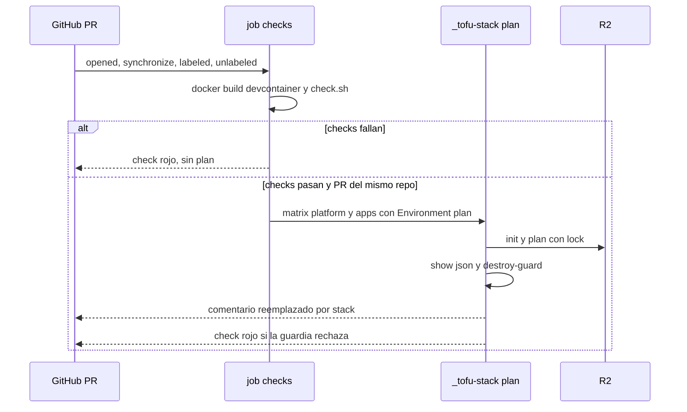
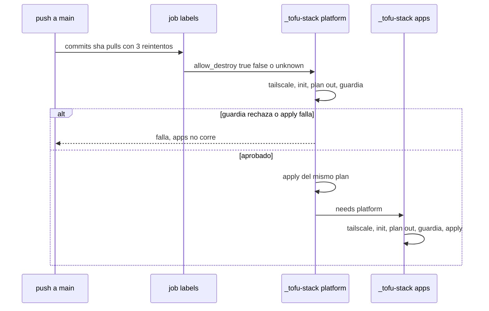

# Design Document: base-y-ci

## Overview
**Purpose**: dejar el repositorio listo para que GitHub Actions sea la única
vía de cambio hacia la nube: stacks vacíos con estado cifrado en R2,
secretos del catálogo siempre cifrados, validación de `app.yaml`, una
verificación local sin credenciales, plan comentado en cada PR, apply solo
desde `main` y una guardia contra destrucciones.

**Users**: el dueño del repositorio (revisa planes y fusiona) y los agentes
de IA (ejecutan `scripts/check.sh` sin credenciales).

**Impact**: crea la estructura, los scripts y los workflows. Agrega el
paquete `python3-jsonschema` al dev container y propone los ADR 0011 y 0012.
No crea recursos en la nube.

### Goals
- `scripts/check.sh` verifica todo sin credenciales.
- Un PR muestra el plan vacío de ambos stacks y el resultado de la guardia.
- Un `secrets.enc.yaml` sin cifrar, o un `app.yaml` inválido, se rechaza
  en el commit y en el PR.
- Al fusionar en `main`, se aplica `platform/` y luego `apps/`, de uno en
  uno.

### Non-Goals
- Recursos reales en los stacks (specs `plataforma` y `apps`).
- `drift.yml`, `backup.yml`, `remove-app.yml`, `destroy.yml` y la copia del
  estado (`backups-y-drift`).
- Renovate (`apps`). Caché de la imagen del CI.

## Boundary Commitments

### This Spec Owns
- La configuración de backend y cifrado de `platform/` y `apps/`.
- Las reglas de cifrado del catálogo (`.sops.yaml`) y su verificación.
- El contrato de formato de `app.yaml` (`schema/app.schema.json`) y su
  validación.
- La orquestación de verificaciones locales (`scripts/check.sh`, pre-commit).
- Los workflows `pr.yml`, `apply.yml` y el reutilizable `_tofu-stack.yml`.
- La guardia contra destrucciones y su contrato de entrada y salida.
- Los ADR 0011 y 0012 y la documentación de credenciales por Environment.

### Out of Boundary
- Cualquier recurso, provider o variable de negocio de los stacks.
- Crear el bucket `tofu-state`, los Environments, sus secretos y la
  protección de `main` (humano).
- Los demás workflows y la copia del estado (`backups-y-drift`).
- Las reglas de catálogo que dependen de varias apps a la vez (por ejemplo,
  hostnames duplicados): `apps`.

### Allowed Dependencies
- Herramientas del dev container (`.devcontainer/Dockerfile`) más
  `python3-jsonschema` (ADR 0012).
- En el CI: `actions/checkout`, `opentofu/setup-opentofu` y
  `tailscale/github-action`, fijadas por SHA. `gh` y `jq` vienen
  preinstalados en `ubuntu-24.04`.
- API de GitHub solo para leer etiquetas de PR y publicar comentarios.
- Ninguna dependencia de `platform/` o `apps/` más allá de su ruta.

### Revalidation Triggers
- Cambios en los nombres de secretos del Environment o en las entradas de
  `_tofu-stack.yml`: revisar `plataforma`, `apps`, `observabilidad` y
  `backups-y-drift`.
- Cambios en `schema/app.schema.json`: revisar `apps` y `catalog-editor`.
- Cambios en la lista de tipos permitidos por la guardia o en su código de
  salida: revisar todas las specs con recursos.
- Cambios en la versión de OpenTofu del Dockerfile: afectan al CI, que la
  lee de ahí.

## Architecture

### Architecture Pattern & Boundary Map



**Architecture Integration**:
- **Selected pattern**: una verificación, un script. Pre-commit y
  `check.sh` invocan los mismos scripts. El CI corre `check.sh` dentro de
  la imagen del dev container y comparte un workflow reutilizable para
  plan y apply.
- **Boundaries**: verificación local (sin credenciales) ↔ CI (con
  credenciales por Environment) ↔ guardia (función pura sobre el plan JSON).
- **Steering compliance**: constitución 2, 3, 7, 8 (ADR 0012) y 9; dos
  stacks con estados separados (`tech.md`).
- **Dependency direction**: scripts ← `check.sh` ← workflows. Los scripts
  no conocen los workflows y la guardia no llama a la API de GitHub.

### Technology Stack

| Layer | Choice / Version | Role in Feature | Notes |
|-------|------------------|-----------------|-------|
| IaC | OpenTofu 1.12.6 (`required_version >= 1.10`) | Stacks, backend, cifrado | Versión del Dockerfile |
| Estado | Backend `s3` en R2, `use_lockfile` | Estado remoto y bloqueo | Endpoint por `AWS_ENDPOINT_URL_S3` |
| Secretos | SOPS 3.13.3 + age 1.3.2 | Cifrado del catálogo | Solo verificación, nunca descifrado |
| Validación | Python 3 + PyYAML + `python3-jsonschema` 4.10.3 | Esquema y reglas de `app.yaml` | ADR 0012 |
| Calidad | tflint 0.64.0, trivy 0.76.1, gitleaks 8.30.1, pre-commit (apt) | Lint, IaC, secretos | Ya en el dev container |
| CI | GitHub Actions, `ubuntu-24.04`, Docker | Checks, plan, apply | Acciones fijadas por SHA |
| Red | `tailscale/github-action` v4 (OAuth, `tag:ci`) | Llegar al servidor | Efímero; logout en el paso post |

## File Structure Plan

### Directory Structure
```
platform/
├── versions.tf          # required_version; sin providers todavía
├── backend.tf           # backend "s3" (key platform/terraform.tfstate) + encryption
└── variables.tf         # state_passphrase (sensitive, >= 16 caracteres)
apps/                    # mismo patrón que platform/ (key apps/terraform.tfstate)
modules/
└── README.md            # propósito del directorio; modules/app llega con la spec apps
schema/
└── app.schema.json      # contrato de app.yaml (JSON Schema 2020-12)
scripts/
├── check.sh             # orquestador de verificaciones (salida concisa)
├── check_sops.py        # cifrado y destinatarios de secrets.enc.yaml
├── check_catalog.py     # esquema + reglas cruzadas de app.yaml
├── destroy-guard.sh     # guardia: plan JSON + allow-destroy → aprobar/rechazar
├── ci/
│   └── pr-comment.sh    # crea o reemplaza el comentario del plan por stack
└── tests/
    ├── test_destroy_guard.sh   # casos 8.1–8.5 con fixtures
    ├── test_check_sops.py      # unittest con fixtures cifrados y sin cifrar
    ├── test_check_catalog.py   # unittest con app.yaml válidos e inválidos
    ├── test_workflows.py       # estático: acciones por SHA, permissions, ramas, concurrencia
    ├── test_pr_comment.sh      # pr-comment.sh con un gh simulado: crea y luego reemplaza
    └── fixtures/
        ├── plans/              # planes JSON de ejemplo
        ├── sops/               # secrets.enc.yaml de ejemplo (sin valores reales)
        └── catalog/            # carpetas de apps de ejemplo
.github/workflows/
├── pr.yml               # checks + plan por stack en cada PR
├── apply.yml            # apply en main: platform → apps
└── _tofu-stack.yml      # reutilizable: init/plan/guardia/(comentario | apply)
.sops.yaml               # reglas de cifrado con las dos llaves públicas age
.pre-commit-config.yaml  # hooks locales (language: system)
.tflint.hcl              # ruleset terraform integrado, preset recommended
.trivyignore             # vacío al inicio; cada excepción, con justificación
docs/adr/0011-environment-plan-para-pr.md
docs/adr/0012-validador-app-yaml.md
```

### Modified Files
- `.devcontainer/Dockerfile`: agrega `python3-jsonschema` y, de forma
  explícita, `python3-yaml` (hoy llega solo como dependencia de pre-commit)
  a la línea de apt (ADR 0012).
- `docs/plan.md` § "Credenciales de la plataforma": columna Environment
  (`plan` / `production`) y alcance de solo lectura de `plan`.
- `docs/guia-implementacion.md` Paso 1: crear el Environment `plan` (regla
  `refs/pull/*/merge`), `production` solo `main`, la prueba de bloqueo de R2,
  y la nota de que Pro no ofrece revisores obligatorios en repos privados.
- `.kiro/steering/tech.md`: ADR 0011–0012, `_tofu-stack.yml`, validador de
  `app.yaml`, bloqueo de R2 verificado.
- `.gitignore`: `plan.json`, `plan.txt` y `tfplan` del CI local.

## System Flows

### Pull request


### Apply en main


Decisiones de flujo: la concurrencia `tofu-production` va a nivel de
workflow en `apply.yml` con `cancel-in-progress: false`. `pr.yml` agrupa por
número de PR: cancela los checks anteriores del mismo PR, pero nunca un plan
en curso, que puede tener tomado el bloqueo del estado. El plan del PR
usa `-lock-timeout=5m` para esperar a un apply en curso.

## Requirements Traceability

| Requirement | Summary | Components | Interfaces | Flows |
|-------------|---------|------------|------------|-------|
| 1.1 | Directorios del plan | Stacks, `modules/README.md`, File Structure | — | — |
| 1.2 | Stacks sin recursos | Stacks | — | PR (plan vacío) |
| 1.3 | Validar sin credenciales | `check.sh` (validate) | `init -backend=false` | — |
| 1.4 | Versiones y lock file | Stacks (`versions.tf`), `check.sh` (lock) | — | — |
| 1.5 | Variables tipadas y sensibles | Stacks (`variables.tf`), tflint | — | — |
| 2.1 | Una llave por stack | Stacks (`backend.tf`) | Contrato de backend | — |
| 2.2 | Cifrado obligatorio | Stacks (`backend.tf`, `enforced`) | — | — |
| 2.3 | Frase solo desde el CI | `variables.tf`, `_tofu-stack.yml` | `TF_VAR_state_passphrase` | PR, Apply |
| 2.4 | Bloqueo | `backend.tf` (`use_lockfile`) | — | — |
| 2.5 | Concurrencia de respaldo | `apply.yml` | `concurrency` | Apply |
| 3.1, 3.2 | Dos destinatarios versionados | `.sops.yaml` | — | — |
| 3.3 | Destinatarios distintos | `check_sops.py` | CLI del script | — |
| 3.4, 3.5 | Rechazo de archivos sin cifrar | `check_sops.py` vía pre-commit y `check.sh` | — | PR |
| 3.6 | Detección de secretos | gitleaks vía pre-commit y `check.sh` | — | PR |
| 3.7 | Sin descifrar | `check_sops.py` (solo lee metadatos) | — | — |
| 4.1 | Esquema con `enabled` | `schema/app.schema.json` | Contrato `app.yaml` | — |
| 4.2–4.8 | Reglas de validación | `app.schema.json`, `check_catalog.py` | CLI del script | PR |
| 4.9 | Ignorar `_*` | `check_catalog.py` | — | — |
| 5.1–5.5 | Orquestador | `check.sh` | Salida y códigos | PR |
| 5.6 | Hooks | `.pre-commit-config.yaml` | — | — |
| 6.1 | Checks en PR | `pr.yml` job `checks` | — | PR |
| 6.2, 6.3 | Plan comentado y reemplazado | `_tofu-stack.yml`, `pr-comment.sh` | Marcador por stack | PR |
| 6.4 | Sin plan si fallan checks | `pr.yml` (`needs`) | — | PR |
| 6.5 | Solo Environment `plan`, sin apply | `_tofu-stack.yml` (`mode: plan`) | Entradas | PR |
| 6.6 | Sensibles ocultos | `tofu show` (texto enmascarado), sin publicar JSON | — | PR |
| 6.7 | Guardia en el PR | `_tofu-stack.yml`, `destroy-guard.sh` | Contrato de la guardia | PR |
| 7.1, 7.5 | Orden y parada | `apply.yml` (`needs`) | — | Apply |
| 7.2 | Solo `main` y `production` | `apply.yml`, regla del Environment | — | Apply |
| 7.3 | Tailscale efímero | `_tofu-stack.yml` | Acción tailscale | Apply |
| 7.4 | Espera sin cancelar | `apply.yml` (`concurrency`) | — | Apply |
| 7.6, 7.7 | Guardia antes y mismo plan | `_tofu-stack.yml` (`-out` → guardia → `apply tfplan`) | — | Apply |
| 8.1–8.5 | Reglas de la guardia | `destroy-guard.sh`, job `labels` | Contrato de la guardia | PR, Apply |
| 8.6 | Pruebas de la guardia | `test_destroy_guard.sh`, fixtures | — | — |
| 9.1, 9.2 | SHA y permisos mínimos | Los tres workflows | `permissions` | — |
| 9.3 | No imprimir credenciales | Workflows (sin `set -x`, secretos enmascarados) | — | — |
| 9.4 | Forks sin credenciales | `pr.yml` (`if` de mismo repo) | — | PR |
| 9.5 | Trivy alto/crítico | `check.sh` (trivy) | — | PR |
| 10.1 | ADR 0011 | `docs/adr/0011-…` | — | — |
| 10.2, 10.3 | Credenciales y pasos manuales | `docs/plan.md`, guía Paso 1 | — | — |

## Components and Interfaces

| Component | Domain | Intent | Req Coverage | Key Dependencies | Contracts |
|-----------|--------|--------|--------------|------------------|-----------|
| Stacks (`platform/`, `apps/`) | IaC | Backend y cifrado sin recursos | 1.1–1.5, 2.1–2.4 | OpenTofu (P0), R2 (P0) | State |
| `.sops.yaml` | Secretos | Destinatarios de cifrado | 3.1, 3.2 | SOPS (P0) | — |
| `check_sops.py` | Verificación | Cifrado y destinatarios | 3.3–3.5, 3.7 | PyYAML (P0) | Batch |
| `app.schema.json` + `check_catalog.py` | Verificación | Formato de `app.yaml` | 4.1–4.9 | jsonschema (P0) | Batch |
| `check.sh` | Verificación | Orquestador | 1.3, 1.4, 3.6, 5.1–5.5, 9.5 | Todas las herramientas (P0) | Batch |
| `.pre-commit-config.yaml` | Verificación | Hooks en el commit | 3.4, 3.6, 4.2, 5.6 | pre-commit (P0) | — |
| `destroy-guard.sh` | Seguridad | Aprobar o rechazar un plan | 8.1–8.5 | jq (P0) | Batch |
| `_tofu-stack.yml` | CI | Init, plan, guardia, comentario o apply | 2.3, 6.2, 6.5–6.7, 7.3, 7.6, 7.7 | setup-opentofu, tailscale (P0) | Batch |
| `pr.yml` | CI | Checks y plan en PR | 6.1, 6.4, 9.4 | Docker (P0) | Event |
| `apply.yml` | CI | Apply ordenado en `main` | 2.5, 7.1, 7.2, 7.4, 7.5, 8.4 | API de GitHub (P1) | Event |
| `pr-comment.sh` | CI | Comentario único por stack | 6.2, 6.3 | `gh` (P1) | Batch |
| ADR y docs | Documentación | Decisión y credenciales | 10.1–10.3 | — | — |

### IaC

#### Stacks (`platform/`, `apps/`)

| Field | Detail |
|-------|--------|
| Intent | Backend y cifrado del estado, sin recursos |
| Requirements | 1.1–1.5, 2.1–2.4 |

**Responsibilities & Constraints**
- `backend "s3"`: `bucket = "tofu-state"`, `key = "<stack>/terraform.tfstate"`,
  `region = "auto"`, `use_path_style`, `use_lockfile = true` y los cinco
  `skip_*` del plan. Sin `endpoints`: llega por `AWS_ENDPOINT_URL_S3`.
- `encryption`: `key_provider "pbkdf2" "main"` con
  `passphrase = var.state_passphrase`, `method "aes_gcm" "main"`, bloques
  `state` y `plan` con `enforced = true`.
- `variable "state_passphrase"`: `type = string`, `sensitive = true`,
  `validation` con `length >= 16`, sin `default`.
- `required_version = ">= 1.10"`. Sin `required_providers` hasta que una
  spec agregue providers. Desde ese momento el lock file es obligatorio.

##### State Management
- **State model**: un objeto por stack en `tofu-state`.
- **Persistence & consistency**: cifrado AES-GCM. Rechaza estado o plan sin
  cifrar.
- **Concurrency strategy**: lock file condicional en R2 más el grupo
  `tofu-production`.

### Verificación

#### `check_sops.py`

| Field | Detail |
|-------|--------|
| Intent | Comprobar que cada `secrets.enc.yaml` esté cifrado para los destinatarios configurados |
| Requirements | 3.3, 3.4, 3.5, 3.7 |

##### Batch / Job Contract
- **Trigger**: pre-commit (archivos `catalog/*/secrets.enc.yaml` en stage) o
  `check.sh` (todos los del catálogo).
- **Input**: rutas opcionales. Sin rutas, busca
  `catalog/*/secrets.enc.yaml`. Lee los destinatarios `age` de la regla de
  `.sops.yaml` que coincide con la ruta.
- **Validation**: el archivo es YAML con un mapa `sops` que tiene `mac` y
  una lista `age`. Cada valor hoja fuera de `sops` empieza con `ENC[`. El
  conjunto de `sops.age[].recipient` es igual al de `.sops.yaml`.
- **Output**: una línea por archivo inválido, `<ruta>: <motivo>` (sin
  valores). Código 0 si todo está bien, 1 si hay inválidos, 2 si
  `.sops.yaml` falta o es inválido.
- **Idempotency**: solo lectura. Nunca invoca `sops` ni lee llaves privadas.

#### `schema/app.schema.json` + `check_catalog.py`

| Field | Detail |
|-------|--------|
| Intent | Validar cada `catalog/<app>/app.yaml` |
| Requirements | 4.1–4.9 |

**Contrato del esquema (Draft 2020-12, `additionalProperties: false` en cada objeto)**

| Campo | Tipo y regla |
|-------|--------------|
| `name` | requerido; `^[a-z0-9]+(-[a-z0-9]+)*$` |
| `enabled` | booleano; por defecto `true` |
| `database.neon` | booleano; por defecto `false` |
| `services` | requerido; objeto con al menos 1 entrada; claves en kebab-case |
| `services.*.image` | requerido; `^[^@\s:]+(:[^@\s]+)?@sha256:[a-f0-9]{64}$` |
| `services.*.port` | requerido; entero 1–65535 |
| `services.*.public` | requerido; booleano |
| `services.*.hostname` | FQDN en minúsculas sin `*`; requerido si `public: true`, prohibido si `public: false` |
| `services.*.healthcheck` | cadena que empieza con `/` |
| `services.*.memory_mb` | requerido; entero ≥ 16 |
| `services.*.uses_database` | booleano; `true` solo si `database.neon: true` (regla `if/then` en la raíz) |
| `services.*.env` | mapa de nombre `^[A-Za-z_][A-Za-z0-9_]*$` a cadena |
| `services.*.secrets` | lista única de nombres `^[A-Za-z_][A-Za-z0-9_]*$` |

##### Batch / Job Contract
- **Input**: rutas opcionales de `app.yaml`. Sin rutas, todas las de
  `catalog/*/app.yaml`, excepto las carpetas que empiezan con `_`.
- **Validation**: el esquema, más `name == <carpeta>` (no expresable en JSON
  Schema).
- **Output**: `<app>: <ruta del campo>: <mensaje>` por error. Código 0 o 1.
  Código 2 si el esquema no carga.

#### `scripts/check.sh`

##### Batch / Job Contract
- **Trigger**: humano, agente o job `checks` del CI.
- **Verificaciones, en orden**:
  1. Herramientas presentes: tofu, tflint, trivy, gitleaks, python3 con
     yaml y jsonschema, y jq.
  2. `tofu fmt -check -recursive`.
  3. `init -backend=false` + `validate` en `platform/`, `apps/` y en cada
     `modules/*`.
  4. Lock file presente en los stacks con `required_providers`.
  5. `tofu test` en cada directorio con `tests/*.tftest.hcl` (si no hay
     ninguno, imprime "omitido").
  6. Pruebas de scripts, descubiertas por patrón: `python3 -m unittest discover scripts/tests` y cada `scripts/tests/test_*.sh`.
  7. `tflint --recursive --config "$PWD/.tflint.hcl"` (ruta absoluta: en modo recursivo tflint 0.64 busca la configuración en cada directorio, no en la raíz).
  8. `trivy config --severity HIGH,CRITICAL --exit-code 1`.
  9. `gitleaks git --redact`.
  10. `check_sops.py`.
  11. `check_catalog.py`.
- **Output**: `ok   <nombre>` por cada verificación que pasa. `FALLA <nombre>`
  seguido de su salida, limitada a 40 líneas, por cada una que falla. Al
  final, `N verificaciones, M fallas`.
- **Exit**: 0 si no hay fallas, 1 si las hay. Siempre corre todas las
  verificaciones. Una herramienta ausente cuenta como falla con
  `falta <herramienta>`.
- **No requiere** credenciales ni variables `TF_VAR_*`.

#### `.pre-commit-config.yaml`
- Solo hooks `repo: local` con `language: system`, para usar las versiones
  de la imagen: `tofu fmt`, `gitleaks git --pre-commit --staged --redact`,
  `check_sops.py` (sobre `secrets.enc.yaml`) y `check_catalog.py` (sobre
  `catalog/*/app.yaml`).

### Seguridad

#### `scripts/destroy-guard.sh`

| Field | Detail |
|-------|--------|
| Intent | Decidir si un plan puede aplicarse según sus destrucciones y la etiqueta |
| Requirements | 8.1–8.5 |

##### Batch / Job Contract
- **Input**: `destroy-guard.sh <plan.json>` y la variable `ALLOW_DESTROY`
  con valor `true`, `false` o `unknown`. Cualquier otro valor se trata como
  `unknown`.
- **Rule**: un recurso está **marcado** si `change.actions` contiene
  `delete` o `forget` y `type` no está en la lista de tipos permitidos
  (`docker_container`).
- **Decision**:

| Situación | Resultado | Código |
|-----------|-----------|--------|
| Plan ilegible o sin `resource_changes` válido | Rechazo | 2 |
| Sin recursos marcados | Aprobado | 0 |
| Con marcados y `ALLOW_DESTROY=true` | Aprobado, con la lista | 0 |
| Con marcados y `false` o `unknown` | Rechazo, con la lista | 1 |

- **Output**: una línea por recurso marcado o contenedor afectado,
  `<acción> <address> (<type>)`, y un veredicto final `APROBADO` o
  `RECHAZADO: <motivo>`. Nunca imprime valores de atributos.
- **Pure**: no llama a la red. La etiqueta la resuelve quien lo invoca.

### CI

#### `_tofu-stack.yml` (reutilizable)

##### Batch / Job Contract
- **Inputs**:

| Input | Tipo | Valores |
|-------|------|---------|
| `stack` | string | `platform`, `apps` |
| `mode` | string | `plan`, `apply` |
| `environment` | string | `plan`, `production` |
| `allow_destroy` | string | `true`, `false`, `unknown` |

- **Secrets** (del Environment, con `secrets: inherit`):
  `R2_ACCESS_KEY_ID`, `R2_SECRET_ACCESS_KEY`, `R2_ENDPOINT`,
  `TF_STATE_PASSPHRASE`, `TS_OAUTH_CLIENT_ID` y `TS_OAUTH_SECRET`. Las specs
  posteriores agregan los suyos y los mapean a `TF_VAR_*` en este archivo.
- **Steps**:
  1. checkout.
  2. Lee `TOFU_VERSION` del Dockerfile y ejecuta `setup-opentofu` con
     `tofu_wrapper: false`.
  3. Tailscale (`tags: tag:ci`).
  4. `init -input=false`.
  5. `plan -input=false -lock-timeout=5m -out=tfplan`.
  6. `show -no-color tfplan > plan.txt` y `show -json tfplan > plan.json`.
  7. Guardia.
  8. Si `mode=plan`: `pr-comment.sh`, y el job falla si la guardia rechazó.
     Si `mode=apply`: `apply -input=false tfplan` solo si la guardia aprobó.
  9. Siempre: borra `plan.json`, `plan.txt` y `tfplan`.
- **Permissions**: no declara `permissions`; hereda las del job llamador,
  que son el techo (`pr.yml`: `contents: read` y `pull-requests: write`;
  `apply.yml`: `contents: read`).
- **Invariant**: `mode=apply` exige `environment=production` y
  `github.ref == refs/heads/main`; en otro caso falla antes del init.

#### `pr.yml`
- **On**: `pull_request` hacia `main` con tipos `opened`, `synchronize`,
  `reopened`, `labeled` y `unlabeled`.
- **Concurrency** (por job): `checks` en `pr-<número>-checks` con
  `cancel-in-progress: true`; `plan` en `pr-<número>-plan-<stack>` con
  `cancel-in-progress: false`, para no dejar huérfano el bloqueo de R2.
- **Job `checks`**: checkout con `fetch-depth: 0`, luego
  `docker build -t infra-tools .devcontainer` y
  `docker run --rm -u "$(id -u):$(id -g)" -v "$PWD:/w" -w /w infra-tools ./scripts/check.sh`.
- **Job `plan`**: `needs: checks`. Solo se ejecuta si
  `github.event.pull_request.head.repo.full_name == github.repository`.
  Recorre `stack` en una matriz `[platform, apps]` y llama a
  `_tofu-stack.yml` con `mode: plan`, `environment: plan` y
  `allow_destroy` según la presencia de la etiqueta `allow-destroy` en el
  PR.

#### `apply.yml`
- **On**: `push` a `main`. Permissions: `contents: read`,
  `pull-requests: read`.
- **Concurrency**: `tofu-production`, con `cancel-in-progress: false`.
- **Job `labels`**: consulta `gh api repos/{repo}/commits/{sha}/pulls` hasta
  3 veces con 5 s de espera. Toma el PR fusionado en `main` y produce
  `allow_destroy` (`true`, `false` o `unknown`).
- **Job `platform`**: `_tofu-stack.yml` con `mode: apply` y
  `environment: production`.
- **Job `apps`**: igual, con `needs: platform`.

#### `scripts/ci/pr-comment.sh`
- **Input**: `<stack> <plan.txt> <resultado de la guardia>`, más
  `GH_TOKEN`, `PR_NUMBER` y `GITHUB_REPOSITORY`.
- **Behavior**: busca el comentario con el marcador
  `<!-- tofu-plan:<stack> -->` y lo reemplaza; si no existe, lo crea. Si el
  plan supera los 60 000 caracteres, lo trunca con un aviso.

## Data Models

### Data Contracts & Integration
- **`app.yaml`**: definido por `schema/app.schema.json` (tabla arriba). Es
  el contrato con la spec `apps` y con el subagente `catalog-editor`.
- **`.sops.yaml`**: una `creation_rule` con
  `path_regex: ^catalog/[^/]+/secrets\.enc\.yaml$` y `age:` con las dos
  llaves públicas separadas por coma.
- **Plan JSON**: se consume solo `resource_changes[].{address,type,change.actions}`.

## Error Handling

### Error Strategy
- **Fallo cerrado**: la guardia rechaza ante cualquier duda (plan ilegible,
  etiqueta `unknown`, valor desconocido).
- **Mensajes accionables**: cada verificación indica la ruta, la app o el
  recurso y el motivo, nunca el valor.
- **Sin efectos parciales en apply**: `apps` no corre si `platform` falla, y
  apply usa el `tfplan` ya evaluado.

### Error Categories and Responses
- **Errores del autor** (`app.yaml` inválido, secreto sin cifrar, fmt):
  rechazo en pre-commit o en el PR, con la ruta y el campo.
- **Errores de entorno** (herramienta ausente, sin red para trivy,
  credencial faltante): falla con el nombre de lo que falta.
- **Bloqueo ocupado**: el plan del PR espera 5 min y luego falla. El apply
  espera en la cola de concurrencia.

### Monitoring
- El estado del check en el PR y los correos de GitHub Actions cuando un
  apply falla. Las alertas del CI se amplían en `backups-y-drift`.

## Testing Strategy

### Unit Tests
- `test_destroy_guard.sh`: casos solo creación (aprobado), reemplazo de
  `docker_container` (aprobado), `delete` de `digitalocean_droplet` con
  `false` (rechazo, código 1, lista), lo mismo con `true` (aprobado con
  lista), `["create","delete"]` y `forget` de un recurso no contenedor con
  `unknown` (rechazo), JSON inválido (código 2) y valor de etiqueta
  desconocido (tratado como `unknown`).
- Todos los fixtures usan valores obviamente falsos y `gitleaks dir scripts/tests/fixtures` no debe reportar nada; si hiciera falta una excepción, se agrega `.gitleaksignore` con justificación.
- `test_check_sops.py`: archivo sin `sops` (rechazo con ruta), valor sin
  `ENC[` (rechazo), destinatarios distintos o incompletos (rechazo) y archivo
  correcto (ok). Los fixtures usan metadatos falsos y no requieren llaves.
- `test_workflows.py`: cada `uses:` de terceros con SHA de 40 caracteres (9.1), `permissions` declarado en cada workflow con disparadores propios; los que solo tienen `workflow_call` quedan exentos porque heredan las del llamador (9.2), `apply.yml` solo en `push` a `main` con `tofu-production` y `cancel-in-progress: false` (7.2, 7.4) y el job `plan` de `pr.yml` condicionado al mismo repo (9.4).
- `test_check_catalog.py`: un caso por regla 4.3–4.8, `name` distinto de la
  carpeta (4.4), carpeta `_template` ignorada (4.9) y `app.yaml` válido.

### Integration Tests
- `check.sh` en el repo limpio: todo `ok` y código 0. Con un fixture inválido
  copiado temporalmente al catálogo: `FALLA` en esa verificación, las demás
  corren y el código es 1 (5.3, 5.4).
- `check.sh` con `PATH` sin `trivy`: `falta trivy` y código 1 (5.5).
- `pre-commit run --all-files` pasa en el repo limpio (5.6).
- `tofu validate` de ambos stacks sin `TF_VAR_state_passphrase` (1.3).

### Puerta en la nube (humano, fuera del alcance del agente)
- Un PR de prueba muestra el plan vacío de ambos stacks y la guardia
  `APROBADO`.
- Un PR con un `secrets.enc.yaml` sin cifrar queda en rojo.
- La fusión de ese PR de prueba ejecuta `apply.yml` sin cambios y en orden.

## Security Considerations
- **Environment `plan`**: regla de rama `refs/pull/*/merge`. No corre en
  forks. Recibe credenciales de solo lectura donde el proveedor lo permita.
  Sí necesita la frase del estado, y desde `apps` también la llave SSH de
  `deploy`. Riesgo aceptado en el ADR 0011: solo el dueño abre PR en un repo
  privado; GitHub Pro no ofrece revisores obligatorios.
- **Environment `production`**: solo `main`. Como `main` está protegida, un
  PR no puede cambiar `apply.yml` sin pasar por la fusión.
- **El plan JSON** contiene valores en claro: no se publica, no se sube como
  artefacto y se borra al terminar. El comentario usa la salida de texto,
  que enmascara los valores sensibles.
- **Acciones**: solo tres de terceros, fijadas por SHA con un comentario de
  versión.
- **La guardia**: aplica una lista de tipos permitidos, no una lista de
  tipos prohibidos. Un provider nuevo queda protegido por defecto.
